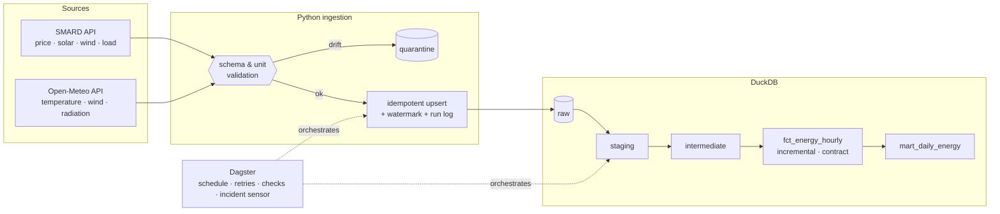

# Energy Data Platform

**An incremental, tested data pipeline for the German electricity market:** day-ahead prices, solar and
wind generation and grid load from SMARD (Bundesnetzagentur), joined with weather from Open-Meteo.
Python ingestion into DuckDB, dbt for modelling and data quality, Dagster for orchestration.

The business question: *how much does wind and solar drive German electricity prices?* The engineering
question this project is really about: *how do you build a pipeline people can depend on?*
Incremental loads, idempotency, schema and unit checks, reconciliation, monitoring, and a runbook
with reproducible failure drills.



## What it shows

| Practice | How |
|---|---|
| **Incremental loads** | Per-series watermarks; each run reads `[watermark − 48h, now)`, the first run backfills 14 days |
| **Idempotency** | Primary keys plus staged upserts: re-running a load never duplicates rows |
| **Late and revised data** | The 48h lookback re-reads recent hours; changed values are counted (`rows_changed`) and applied |
| **Schema and unit checks** | Pydantic models validate every response; drift is quarantined and never loaded |
| **Failure isolation** | One bad series fails alone; watermarks only advance on success, so the next run catches up |
| **dbt modelling** | staging → intermediate → marts; incremental fact table (`delete+insert`, 48h window) with an enforced **model contract** |
| **Data quality** | 26 dbt tests: uniqueness, not-null, accepted values, value ranges (EPEX price limits), **reconciliation raw ↔ fact**, completeness, **source freshness**; failing rows are stored for debugging |
| **Orchestration** | Dagster assets with one lineage graph (ingestion → dbt), schedule, retries with backoff (not for schema drift), asset checks, run-failure sensor |
| **Operability** | `edp status` (watermarks, run log, quarantine), a [runbook](docs/RUNBOOK.md) and **7 reproducible failure drills** |
| **Testing and CI** | 11 pytest tests incl. the real dbt project; GitHub Actions runs tests, the full pipeline and dbt docs offline |

## Quickstart

```bash
git clone https://github.com/py3de/energy-data-platform.git
cd energy-data-platform
python -m venv .venv
source .venv/bin/activate            # Windows: .venv\Scripts\activate
pip install -e ".[dev]"

edp run                               # ingest the last 14 days + dbt build
edp status                            # watermarks, load runs, quarantine
dagster dev -m orchestration.definitions   # UI at http://localhost:3000
```

No API keys are needed: both sources are free. To work without network, set `EDP_OFFLINE=1`: the pipeline then
uses recorded real API responses from `fixtures/` (that's also how CI runs).

Query the results:

```bash
python -c "import duckdb; print(duckdb.connect('data/warehouse.duckdb').sql('select * from marts.mart_daily_energy order by 1 desc'))"
```

## Failure drills

Each drill builds a healthy demo warehouse (separate file, your data is untouched), breaks one thing and runs
the step that should catch it:

```bash
edp chaos list
edp chaos revision         # SMARD corrects a past value -> detected, applied, reconciliation still passes
edp chaos negative_value   # corrupt value -> dbt test fails, downstream mart is skipped
edp chaos schema_change    # API format changes -> validation fails, payload quarantined, other series still load
```

| Drill | Detected by |
|---|---|
| `schema_change` | Pydantic validation → quarantine |
| `unit_change` | Unit check → quarantine |
| `api_outage` | Run log + Dagster retries, watermark unchanged |
| `revision` | Lookback window, `rows_changed`, incremental fact update |
| `negative_value` | dbt `not_negative`, downstream skipped |
| `missing_hours` | dbt reconciliation test |
| `stale_source` | dbt source freshness / Dagster freshness check |

How to diagnose and fix each one: [docs/RUNBOOK.md](docs/RUNBOOK.md).

## Data model

| Model | Grain | Notes |
|---|---|---|
| `stg_smard__series` | series × hour | renamed raw SMARD data |
| `stg_open_meteo__weather` | location × hour | clear units in column names |
| `int_energy__hourly` | hour | long → wide pivot of the five series |
| `int_weather__germany_hourly` | hour | average of Hamburg, Munich and Frankfurt |
| `fct_energy_hourly` | hour (UTC + Europe/Berlin) | price, generation, load, wind/solar share, weather, `is_complete` flag |
| `mart_daily_energy` | German delivery day | averages, min/max price, negative-price hours, price vs. wind/solar correlation |

In the recorded sample (16–17 Nov 2026), hours with a higher wind and solar share had clearly lower day-ahead
prices: the daily correlation was −0.76 and −0.54.

## Design decisions

- **The watermark is the newest hour actually loaded, not the run time.** If a source publishes late, the next
  run still asks for the missing hours. Watermarks only move when a load succeeds.
- **A lookback window instead of trusting "new rows only".** SMARD revises recent values. Re-reading 48 hours is
  cheap and turns silent errors into counted, visible changes.
- **Validate before writing, and quarantine what fails.** A changed format or unit is a contract break, not a
  transient error, so it is not retried. The payload is kept for the fix and the test that comes with it.
- **Reconciliation as a test.** Row and value totals between raw and fact must match. This catches the failures
  that pass every column-level test (lost rows, a revision outside the incremental window).
- **An enforced dbt contract on the fact table.** Column names and types are a promise to downstream users;
  breaking them fails the build instead of a dashboard.
- **DuckDB locally, the same patterns in the cloud.** Watermarks, upserts, dbt incremental models and Dagster
  assets map directly onto S3/Iceberg with Glue, Snowflake or Databricks.

## Project structure

```
src/energy_platform/
  config.py           series, locations, lookback and initial-load settings
  sources/            SMARD and Open-Meteo clients with pydantic validation and quarantine
  ingest.py           incremental loads: window, upsert, watermark, run log
  db.py               DuckDB schema, idempotent upsert, run log
  http.py             HTTP client, offline fixtures and failure injection
  chaos.py            reproducible failure drills
  cli.py              `edp` command line
transform/            dbt project (models, tests, contract, freshness)
orchestration/        Dagster definitions (assets, checks, schedule, sensor)
fixtures/             recorded real API responses (offline mode, CI)
docs/RUNBOOK.md       diagnosis and fixes for every failure drill
tests/                pytest, including the real dbt project
```

## Roadmap

- [ ] AI "pipeline doctor": an agent that reads failed runs and test failures read-only, proposes a fix and
      applies it only after human approval (reusing the governance layer from my
      [Mini Agent Stack](https://github.com/py3de/mini-agent-stackV1))
- [ ] S3 + Apache Iceberg with AWS Glue, provisioned with Terraform
- [ ] SCD Type 2 snapshot for slowly changing reference data

## Data sources and licences

- Electricity market data: **Bundesnetzagentur | SMARD.de**, licensed under CC BY 4.0.
- Weather data: **Open-Meteo.com**, licensed under CC BY 4.0.

Code: MIT.
